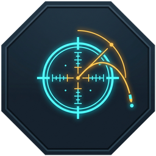

  
  <h1>WARDOGS Mortar Calculator</h1>
  
<b>Координаты с карты → азимут, прицел и дистанция.</b>

  
Оверлей для миномёта в WARDOGS · Дальность 80–684 м · Русский / English

  

    
    
    
  

  
<a href="#запуск">Запуск</a> · <a href="#управление">Управление</a> · <a href="WardogsGameBarCpp/docs/BUILD.md">Сборка</a>

---

## Запуск

| Xbox Game Bar | Portable |
| :--- | :--- |
| **`WardogsGameBar.msix`** | **`WardogsPortable.exe`** |
| Установите пакет → **Win + G** → выберите калькулятор в виджетах. Закрепите булавкой, чтобы он оставался поверх игры. | Запустите EXE без установки. Если появится проверка OCR — следуйте подсказке. |

## Управление

Наведите курсор на координаты орудия и нажмите **F1**, затем на координаты цели — **F2**. Результат появится в оверлее.

| Клавиша | Действие |
| --- | --- |
| **`F1`** | Позиция орудия |
| **`F2`** | Позиция цели |
| **`F3`** | Настройки |
| **`F4`** | Скрыть / показать |

В настройках — язык RU/EN, прозрачность, размер захвата, превью, горячие клавиши и ручной ввод X/Y. В Portable окно перемещается за заголовок в режиме F3. Сквозной режим пропускает клики в игру; в Game Bar он включается на самой панели.

Для выхода закройте виджет или нажмите F3 и крестик в Portable. **F4 только скрывает окно.**

### Подсказка прицела — Portable 0.2.0

После F1/F2 откройте прицел миномёта и нажмите **F5**. Область **левой шкалы дальности** определяется автоматически относительно центра окна игры — курсор можно оставить в центре. Риска протянется от шкалы до вертикали центра прицела. В HUD появится мини-превью шкалы. Прицел наводите сами: совместите риску с центральным кружком.

| Клавиша | Действие |
| --- | --- |
| **`F5`** | Один снимок левой шкалы прицела, обновить риску |
| **`F6`** | Включить / выключить сопровождение левой шкалы |
| **`F7`** | Убрать риску и остановить сопровождение |

После прокрутки разовую риску обновляйте F5; она исчезает через 8 секунд. F6 повторно считывает только область левой шкалы, пока режим включён; предварительно нажимать F5 не обязательно. Если нужная дальность за видимой шкалой, HUD подскажет направление докрутки. Если шкала не читается, линия скрывается. F7 убирает её сразу — используйте при выходе из прицела. Скрытие HUD, новые F1/F2 и переключение окна также сбрасывают подсказку. F5–F7 закреплены за этими действиями.

Подсказка рассчитана на стандартный прицел L81 с кружком по центру окна игры. Область захвата смещена влево от центра и масштабируется по высоте окна; сами деления находятся по изображению. Требуются три согласованных деления. Если часть штрихов теряется на фоне, используются минимум три читаемые подписи с привязкой хотя бы к одному найденному штриху; HUD сообщает об этом. В сопровождении потеря шкалы останавливает режим после трёх неудачных проверок. Все снимки остаются в RAM.

## Что нужно

**Windows 10 2004+ / Windows 11 x64**, оконный режим или Borderless. Для распознавания нужен английский компонент **Optical Character Recognition** из параметров языка Windows.

Windows OCR может быть недоступен в Portable даже с установленным языком: Microsoft официально поддерживает его у приложений, установленных пакетом. В этом случае используйте Game Bar-версию или ручной ввод.

Калькулятор не вмешивается в игру и не сохраняет снимки экрана. На диске остаются только настройки. Правила использования сторонних инструментов определяют разработчики WARDOGS; гарантии от бана нет.

---

  
Основано на <a href="https://github.com/ProDexortie/wardogs-mortar-calculator">проекте ProDexortie</a>.

  
Copyright (c) 2026 ProDexortie · <a href="LICENSE">MIT License</a>

