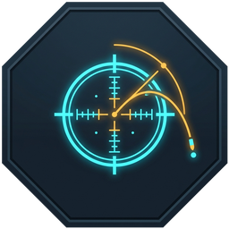

  
  <h1>WARDOGS Mortar Calculator</h1>
  
<b>Координаты с карты → азимут, прицел и дистанция.</b>

  
Оверлей для L81 и SPH-2 в WARDOGS · Русский / English

  

    
    
    
  

  
<a href="#запуск">Запуск</a> · <a href="#управление">Управление</a> · <a href="WardogsGameBarCpp/docs/BUILD.md">Сборка</a>

---

## Запуск

| Xbox Game Bar | Portable |
| :--- | :--- |
| **`WardogsGameBar.msix`** | **`WardogsPortable.exe`** |
| Установите пакет → **Win + G** → выберите калькулятор в виджетах. Закрепите булавкой, чтобы он оставался поверх игры. | Запустите EXE без установки. Если появится проверка OCR — следуйте подсказке. |

## Управление

Наведите курсор на координаты орудия и нажмите **F1**, затем на координаты цели — **F2**. Результат появится в оверлее.

| Клавиша | Действие |
| --- | --- |
| **`F1`** | Позиция орудия |
| **`F2`** | Позиция цели |
| **`F3`** | Настройки |
| **`F4`** | Скрыть / показать |

В настройках — язык RU/EN, прозрачность, размер захвата, превью, горячие клавиши и ручной ввод X/Y. В Portable окно перемещается за заголовок в режиме F3. Сквозной режим пропускает клики в игру; в Game Bar он включается на самой панели.

Для выхода закройте виджет или нажмите F3 и крестик в Portable. **F4 только скрывает окно.**

### Подсказка прицела — Portable 0.3.0

После F1/F2 откройте прицел и нажмите **F5**. Горизонтальная линия показывает дальность, вертикальная — азимут. Совместите линии с центром прицела. Стрелки сбоку и сверху подсказывают направление поворота. Если цель за видимой шкалой, остаётся только стрелка.

| Клавиша | Действие |
| --- | --- |
| **`F5`** | Разовая проверка шкал дальности и азимута |
| **`F6`** | Включить / выключить сопровождение |
| **`F7`** | Убрать подсказки и остановить сопровождение |
| **`F8`** | Переключить L81 / SPH-2; затем обновить позицию через F1 |
| **`F9`** | Переключить верхнюю / нижнюю ветвь SPH-2 |

После прокрутки разовую подсказку обновляйте F5; она исчезает через 8 секунд. F6 повторно считывает шкалы, пока режим включён. F7, новые F1/F2, скрытие HUD и смена окна сбрасывают подсказку. F5–F9 закреплены за указанными действиями. Снимки остаются в RAM.

Области шкал определяются относительно центра окна игры. Распознавание сравнивает исходное изображение, локальный контраст, каналы R/G/B, минимум/максимум каналов и обратную полярность. Для L81 выделяются тёмные риски, для SPH-2 — светлые; чёрные цифры верхнего азимута читаются отдельно от белых рисок. Для линии нужны три согласованные подписи и совпадение результата минимум в двух вариантах обработки; дальность также привязывается к найденному штриху, а азимут — к трём рискам. HUD показывает выбранные фильтры и превью обеих шкал. Если шкала не читается, соответствующая линия скрывается. Число проходов ограничено временем, чтобы не показывать устаревшую подсказку.

**SPH-2:** верхняя ветвь откалибрована по снимкам от **734 м / 1400 mil** до **2629 м / 620 mil**. Дальше дальность уменьшается — этот участок выбирается отдельно через F9. Для нижней ветви известны интервалы 1179–1382 и 1528–2629 м; промежуток не интерполируется. Повторяющиеся подписи метров у вершины не используются как однозначные отметки OCR.

Калибровка SPH-2 экспериментальная: одно место, снаряд и масштаб прицела. **Наклон корпуса и разница высот не учтены.** После переезда обновляйте координаты орудия через F1. Подсказки рассчитаны на показанные стандартные прицелы с центром в середине окна; другой масштаб требует проверки.

## Что нужно

**Windows 10 2004+ / Windows 11 x64**, оконный режим или Borderless. Для распознавания нужен английский компонент **Optical Character Recognition** из параметров языка Windows.

Windows OCR может быть недоступен в Portable даже с установленным языком: Microsoft официально поддерживает его у приложений, установленных пакетом. В этом случае используйте Game Bar-версию или ручной ввод.

Калькулятор не вмешивается в игру и не сохраняет снимки экрана. На диске остаются только настройки. Правила использования сторонних инструментов определяют разработчики WARDOGS; гарантии от бана нет.

---

  
Основано на <a href="https://github.com/ProDexortie/wardogs-mortar-calculator">проекте ProDexortie</a>.

  
Copyright (c) 2026 ProDexortie · <a href="LICENSE">MIT License</a>

